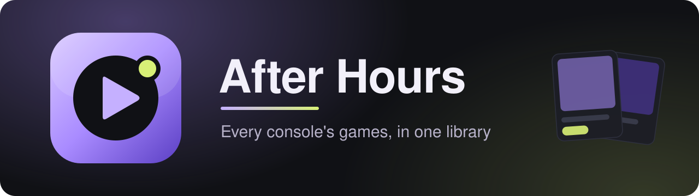

<p align="center">
  
</p>

<p align="center">
  <a href="https://github.com/pretend7979/after-hours/releases/latest"></a>
  <a href="https://github.com/pretend7979/after-hours/releases"></a>
  <a href="LICENSE.txt"></a>
  
</p>

<p align="center">
  <a href="#download">Download</a> &nbsp;&bull;&nbsp;
  <a href="#features">Features</a> &nbsp;&bull;&nbsp;
  <a href="#building-windows-msys2-clang64">Building</a> &nbsp;&bull;&nbsp;
  <a href="#licences">Licences</a>
</p>

A game library for every console: your games from all your systems in one place, with box art,
details and trailers from IGDB, each started in its own emulator.

## Download

Get the latest build from [Releases](https://github.com/pretend7979/after-hours/releases),
unzip it anywhere and run `afterhours.exe`. The first-run setup asks for your emulators and
game folders; After Hours checks these releases for its own updates.

## Features

- **Every console in one sidebar**, grouped by maker, with logos and a game count for each.
- **Game cards** with box art and a Play button; Details opens the description and trailer.
- **Emulators downloaded and updated for you** from their official GitHub releases, or point it
  at ones you already have. Several copies per console, and a choice per game.
- **Switch 2 games play in [PreTenDo Emulator](https://github.com/pretend7979/pretendo-emulator)**,
  with per-game settings one click away.
- **Per-console settings**: emulator, launch arguments and game folders.

After Hours ships no emulators, BIOS, keys, firmware or games.

## Building (Windows, MSYS2 clang64)

Needs Qt 6 (Widgets, Network, Concurrent) and Ninja from the MSYS2 clang64 environment.

```
cmake -G Ninja -S . -B build -DCMAKE_PREFIX_PATH=C:/msys64/clang64
cmake --build build
```

Game details and art come from the After Hours metadata API, so builds need no keys. To use
your own server, pass `-DAFTERHOURS_METADATA_URL=http://your-server` when configuring.

## Metadata server

`server/` holds the metadata API: one Python file (standard library only), a systemd unit and an
nginx site. It logs in to IGDB with your Twitch app's client id and secret, kept in
`/etc/pretendulator-api/env` on the server (never in this repository), and keeps every answer and
image, so each game reaches IGDB once. See the top of `server/pretendulator_api.py` for its
endpoints.

## Packaging

```
python packaging/package_afterhours.py <version> [output folder]
```

builds `After-Hours-<version>-windows-x64.zip` with the DLLs and Qt plugins the program uses
and their licences.

## Data

A `user` folder next to `afterhours.exe` makes it portable; otherwise settings and cached
details live in `%APPDATA%\After Hours` (an existing `%APPDATA%\Pretendulator` folder
from before the rename is moved there).

## Licences

After Hours Arcade Manager is GPL-3.0-or-later. Console logos: see `dist/logos/LICENSE.txt`. The
WebView2 SDK in `externals/webview2` is Microsoft's, under its own licence.
